# Registros de uso de IA

## Descrição
O projeto **Registros de uso de IA** tem como objetivo gerenciar e monitorar os registros de usos de IA.

O sistema permite realizar o cadastro de usuários, registrar informações, consultar, atualizar e excluir registros e etc.

---

## Diagrama de Classes
<p align="left">
  
</p>
<p align="left">
  
</p>

---

## Tecnologias
* JavaScript
* Node.js
* Express
* MySQL
* MySQL2
* Insomnia

---

## Passo a passo para testar

### 1. Clonar o repositório
```bash
git clone URL_DO_REPOSITORIO
```

### 2. Acessar a pasta do projeto
```bash
cd NOME_DO_PROJETO
```

### 3. Instalar as dependências
```bash
npm install mysql2, express, cors
```

### 4. Configurar o banco de dados
* Abrir o MySQL.
* Executar o script SQL disponibilizado no projeto.
* O script criará o banco de dados `usos_ia`, as tabelas `usuario` e `usoia` e inserirá dados para testes.

### 5. Iniciar o servidor
```bash
npm run dev
```

O servidor estará disponível em:
```text
http://localhost:3000
```

### 6. Testar a API no Insomnia
Utilizar o Insomnia para realizar requisições HTTP e testar as funcionalidades do sistema.

---


## Testes do Insomnia

## Testes usuarios
### Login usuario
<p align="left">
  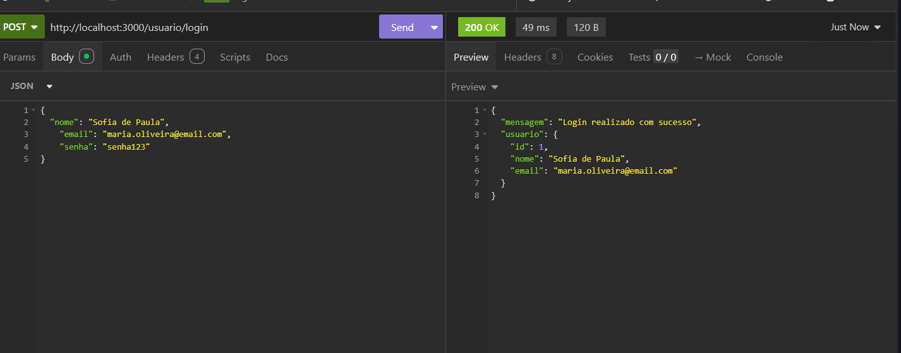
</p>

### Listar usuario
<p align="left">
  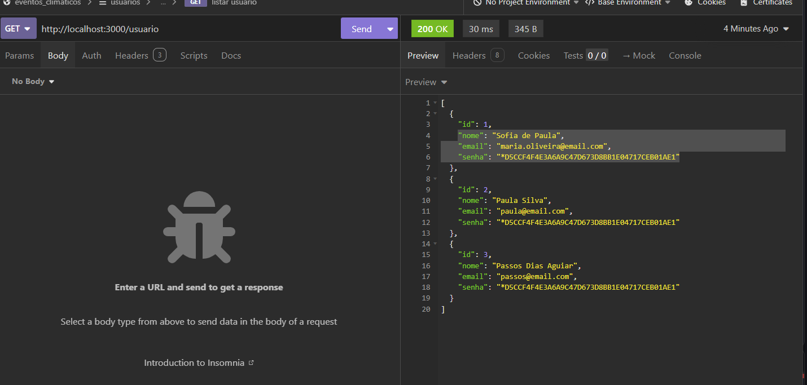
</p>

### Buscar usuario
<p align="left">
  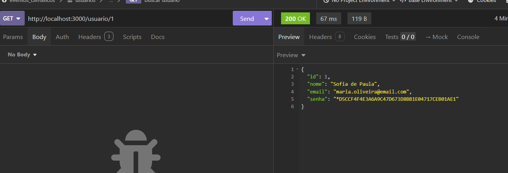
</p>

### Cadastrar usuario
<p align="left">
  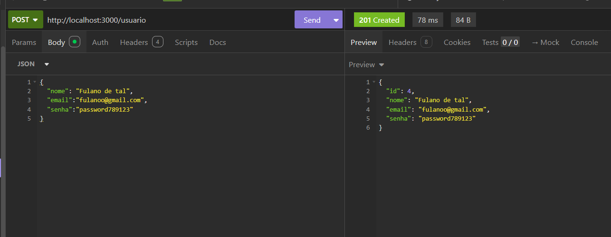
</p>

### Deletar usuario
<p align="left">
  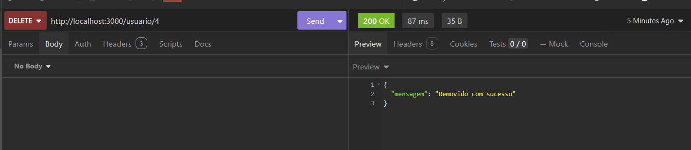
</p>

### Atualizar usuario
<p align="left">
  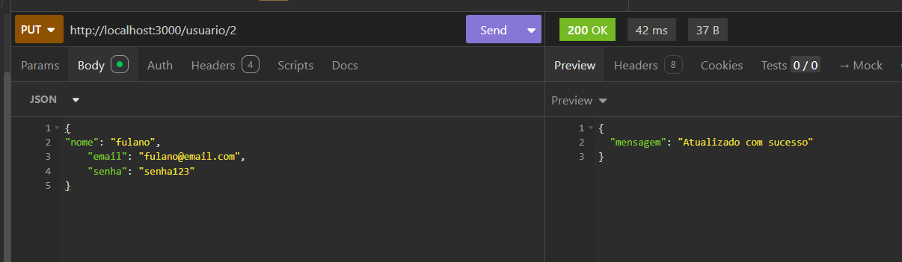
</p>

## Testes usos IA
### Listar usos IA
<p align="left">
  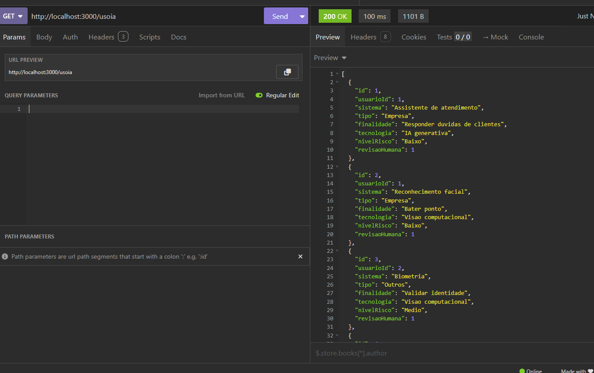
</p>

### Buscar usos IA
<p align="left">
  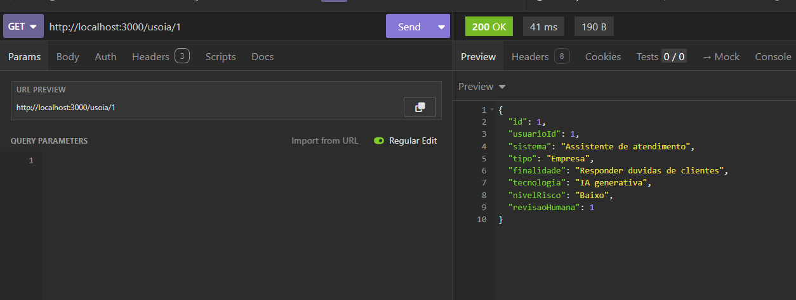
</p>

### Postar usos IA
<p align="left">
  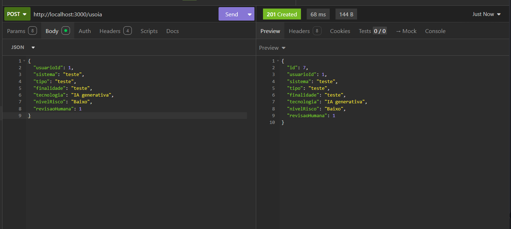
</p>

### Deletar usos IA
<p align="left">
  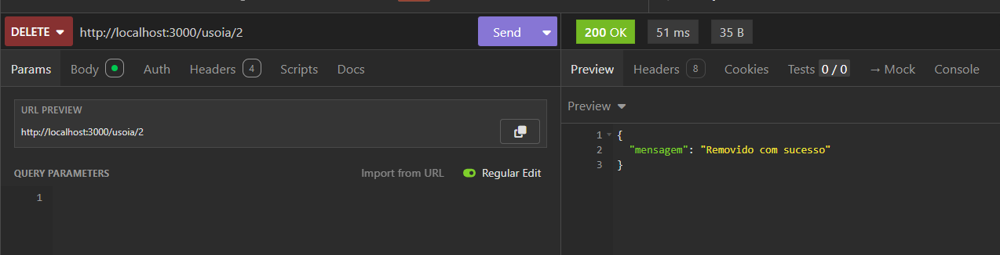
</p>

### Atualizar usos IA
<p align="left">
  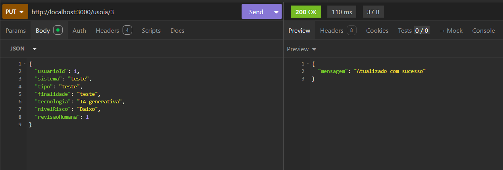
</p>

### Resumo usos IA
<p align="left">
  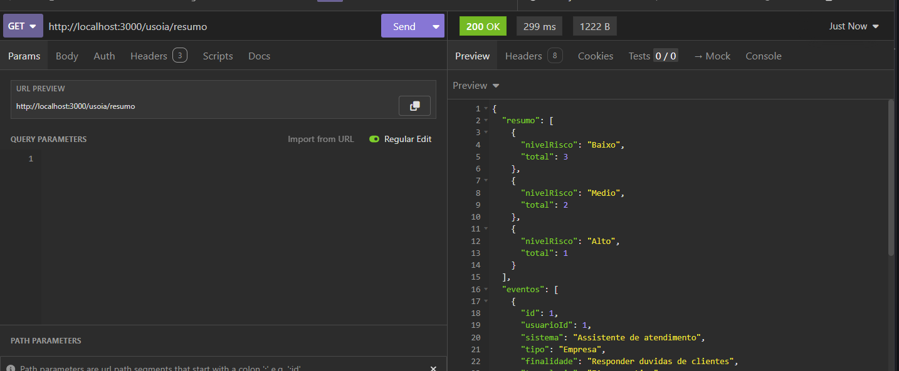
</p>
